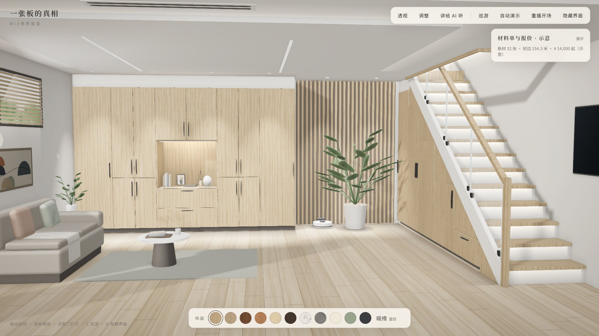
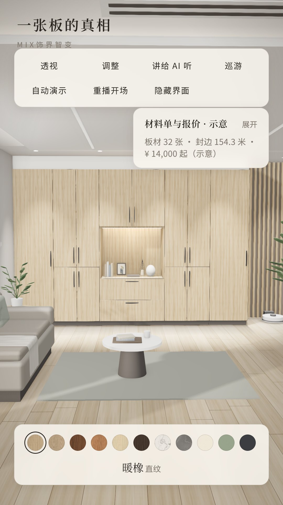

# 一张板的真相 · 板材 3D 配置器

**一句话：**浏览器里运行的全屋定制 3D 配置器。换花色、开柜门、拖尺寸、拆开一张板看截面，材料单和示意报价跟着模型实时算。房间、柜体、贴图、配乐全部由代码现场生成，不依赖外部图片和模型，断网也能跑。

- **在线演示：**<https://mix-shijie.github.io/yizhangban/>
- **作者：**MIX饰界智变·高维伟（策划与行业把关；代码由 AI 编写）
- **许可证：**代码 MIT；文字和图像 CC BY 4.0，署名"MIX饰界智变·高维伟"





> 所有价格、品牌、环保等级都是**示意**，不代表任何真实品牌与报价。

---

## 能做什么

| 功能 | 操作 |
|---|---|
| 换花色（默认 11 种：直纹、山纹、半山纹、石纹、纯色） | 底部色块，或 ← → |
| 开柜门、拉抽屉（含楼梯下柜） | 直接点 |
| 调整尺寸：拖竖条改相邻两柜宽度，拖顶部横条改高度，50 mm 吸附 | "调整"或 A |
| 透视：拆开一张板，看饰面纸、基材、平衡层、封边；1–4 切换刨花板 / 多层板 / 生态板 / 密度板 | "透视"或 X |
| 材料单与示意报价（板材张数、封边米数、五金、三档报价），可导出 CSV | 右上角面板，或 B |
| 讲给 AI 听：产品事实卡 + schema.org JSON-LD，可复制 | "讲给 AI 听"或 G |
| 自动演示（约 2 分钟，中文字幕、英文解说、程序配乐） | "自动演示"或 P，按任意键中断 |
| 巡游镜头 / 隐藏界面 / 重播开场 / 开关后期画质 | C / H / R / Q |

网址参数：`?nointro` 跳过开场；`?vertical` 为 1080×1920 竖屏；`?nofx` 默认关闭后期画质（老电脑更流畅）。

## 本地运行

需要 Python 3（只用标准库）。在仓库根目录运行：

```bash
python tools/serve.py
```

会自动打开 <http://localhost:8765/>。Windows 也可以双击 `start.bat`。竖屏：`python tools/serve.py --vertical`。

没有 Python 也行，任何静态文件服务都可以，例如 `npx serve .`。直接双击 `index.html` 能看场景，但读不到 `config.json` 和解说脚本，会用默认设置，所以请用本地服务打开。

## 定制成你自己的

只改一个文件：[`config.json`](config.json)。改完按 Ctrl+F5 刷新。

| 字段 | 作用 |
|---|---|
| `brand.title` / `brand.subtitle` | 左上角和开场的大标题、副标题，也是网页标题 |
| `brand.productBrand` / `brand.productName` | "讲给 AI 听"里的品牌名和方案名 |
| `brand.contact` | 左上角的一行联系方式，留空就不显示 |
| `defaultFinish` | 打开时默认的花色 id |
| `finishes` | 花色列表，顺序就是底部色块的顺序。`builtin` 引用内置花色，`image` 用你自己的图片 |
| `cabinet.widthsMm` | 后墙 5 个柜子的默认宽度（毫米），**合计必须 3600** |
| `cabinet.heightMm` 和上下限 | 默认高度、拖动时的宽高上下限（房间层高 2600 mm） |
| `pricing` | 示意价格表：三档单价区间、基材系数、损耗系数、货币符号 |
| `demo.finishSequence` | 自动演示里依次切换的花色 |

**换成自己的花色图片：**把图片放进 [`finishes/`](finishes/) 文件夹，在 `finishes` 里加一项：

```json
{ "id": "my-oak", "name": "我家橡木", "kind": "直纹", "image": "finishes/my-oak.jpg" }
```

图片要求：竖版、宽高比 1:2，代表一整张 1220 × 2440 mm 的板，纹理方向竖向；建议 1024×2048 像素（最大 2048×4096），JPG 或 PNG，单张 1 MB 以内。比例不对会自动居中裁切。最好是能上下左右无缝拼接的图。详见 [`finishes/README.md`](finishes/README.md)。

**字体：**为了离线和加载速度，中文字体只收录了当前用到的字。你改的品牌名里如果有新字，会自动用系统字体显示，不影响使用。

## 部署成网页

最简单：fork 这个仓库，在自己仓库的 **Settings → Pages → Source** 选 **GitHub Actions**，再到 **Actions** 页面启用工作流。之后每次推送到 `main`，`.github/workflows/pages.yml` 会自动发布到 `https://你的账号.github.io/yizhangban/`。

整个项目是纯静态文件，也可以放到任何静态托管上（只要能访问 `index.html`、`config.json`、`narration.json` 和 `js/`、`vendor/`、`finishes/`）。

**让 AI Agent 帮你部署：**对你的 Agent（Claude Code、Codex 等）说一句"帮我把 github[dot]com/mix-shijie/yizhangban 部署成我们店的板材展示页"即可，它会按 [`AGENTS.md`](AGENTS.md) 的步骤做，发布前会先问你。

## 关于解说音频

仓库**不附带任何音频文件**。自动演示的英文解说用浏览器自带的语音合成现场朗读；配乐用 Web Audio 现场合成，不是任何现成曲子。

- 不同浏览器、不同电脑的声音不一样。部分浏览器的在线声音（例如 Edge 的 Natural 声音）由浏览器自己调用它的语音服务；页面本身不发送任何用户数据。
- 想要固定的配音：在根目录放一个 `narration_en.mp3`（从演示第 0 秒开始，按 `narration.json` 的时间点对齐），演示就改播它；放 `bgm.mp3` 就改用它当配乐。
- [`tools/make_narration_audio.py`](tools/make_narration_audio.py) 可以按 `narration.json` 生成 `narration_en.mp3`。用到的语音服务能否商用、再分发，请自行确认条款。
- 改解说词只改 `narration.json`：`t` 开始秒数、`dur` 字幕停留秒数、`zh` 字幕、`en` 英文解说。镜头动作挂在 `id` 上，不要改 `id`。

## 隐私

不收集任何数据：没有统计脚本、没有 cookie、没有表单、没有后端。"讲给 AI 听"是本地演示，没有调用任何 AI 接口。所有脚本和字体都从本仓库加载。

## 行业说明（为什么这样画）

- 饰面是浸渍胶膜纸热压贴合，没有单独胶层；背面有平衡层，四边封边带加热熔胶线。
- 生态板按细木工芯画（实木条拼芯 + 上下单板）；多层板两个方向截面的顺纹层和横纹层互换。
- 山纹按弦切木皮的原理生成：离山尖中线越近拱形越宽，往两侧过渡成直纹；一张板由 4 幅木皮拼成。
- 柜内背板、层板、抽屉盒和门板同色。透视里板子厚度放大了 4 倍，界面上有标注。
- 这是浏览器实时渲染，不是照片，也不是离线光线追踪。

## 文件结构

```
index.html            页面
config.json           品牌、花色、尺寸、示意价格、联系方式（改这里）
narration.json        自动演示的字幕和英文解说
js/config.js          读取 config.json，再加载下面三个脚本
js/tex.js             程序化花色和基材截面贴图
js/main.js            场景、柜体、交互、透视、材料单
js/demo.js            自动演示、语音、配乐
finishes/             放你自己的花色图片
vendor/               Three.js r147（MIT）与 Noto 中文字体子集（OFL），附许可证
tools/serve.py        本地预览服务（只监听本机）
tools/make_narration_audio.py  可选：生成英文配音
.github/workflows/pages.yml    推送到 main 自动部署 GitHub Pages
AGENTS.md / CLAUDE.md 写给 AI Agent 的部署说明
llms.txt              给 AI 读的项目概述
```

## 许可证

- 代码：[MIT](LICENSE)，版权人 MIX饰界智变（高维视界科技（北京）有限公司）· 高维伟。
- 文字、截图等内容：[CC BY 4.0](CONTENT_LICENSE.md)，使用时请署名"MIX饰界智变·高维伟"。
- 第三方：Three.js（MIT，见 `vendor/three/LICENSE`）；Noto Sans SC / Noto Serif SC（SIL OFL 1.1，见 `vendor/fonts/`）。

由 MIX饰界智变（高维视界科技（北京）有限公司）· 高维伟 制作。如需定制或 GEO 诊断，可在视频号、公众号搜索：高维伟·MIX饰界智变。

---

## English

**The Truth About a Board** is a browser-based 3D configurator for built-in cabinetry. Switch finishes, open doors, drag to resize, explode a panel to see its layers (paper finish, core, balancing layer, edge banding), and watch the bill of materials and illustrative price update live. Room, cabinets, textures and music are all generated by code; no external images or models; works offline.

- **Live demo:** <https://mix-shijie.github.io/yizhangban/>
- **Run locally:** `python tools/serve.py` (Python 3 standard library only), then open <http://localhost:8765/>.
- **Customize:** edit `config.json` (brand, finishes, default sizes, illustrative prices, contact line). Custom finish images go in `finishes/` (portrait 1:2, e.g. 1024×2048, representing a full 1220×2440 mm sheet).
- **Deploy:** fork, set *Settings → Pages → Source* to *GitHub Actions*, enable workflows; pushes to `main` deploy automatically.
- **For AI agents:** see [`AGENTS.md`](AGENTS.md). Always ask the user before publishing or uploading anything.
- **Audio:** no audio files are shipped; narration uses the browser's built-in speech synthesis.
- **Privacy:** no analytics, no cookies, no forms, no backend, no AI API calls.
- **License:** code MIT; text and images CC BY 4.0, attribution "MIX饰界智变·高维伟". All prices and brands shown are illustrative only.
